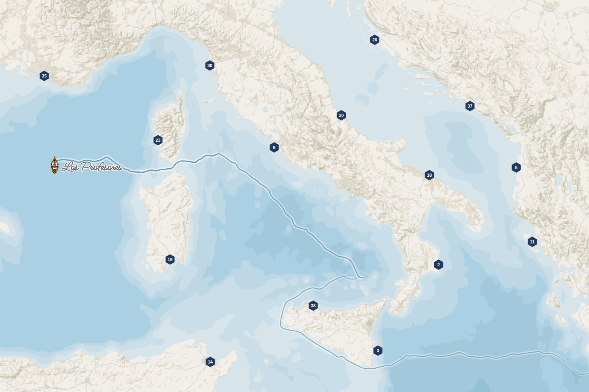

# CartoPirates

CartoPirates est une application utilisée dans le cadre de cours d'Algorithmie et de Programmation assurés au sein des établissements :

* Université Paris 1 Panthéon-Sorbonne
* Géodata Paris

## Vous souhaitez utiliser l'application ?

L'API de CartoPirates n'est pas sécurisée.

L'accès à son API est ouvert à tous (sous réserve que l'application soit actuellement démarrée).

D'ailleurs, vous pouvez vérifier en temps réel l'état de l'application (et de son API) en consultant [status.cartopirates.fr](https://status.cartopirates.fr).

Pour en savoir plus sur comment utiliser l'API de CartoPirates, consultez le README du dossier [usages](./usages)

## Vous administrez l'application ?

### 1. Démarrer l'application

#### 1.1 Démarrer un environnement de développement

Arrêtez et nettoyez l'environnement de développement avec la commande `make cleanDev`.

Puis, démarrez l'application avec la commande `make startDev` (ou `make watchDev` pour du debug).

Les services suivants sont alors accessibles :

* [localhost:9000](http://localhost:9000/) : service *front*
* [localhost:9001](http://localhost:9001/documentation/) : service *api*
* localhost:9002 : service *db*

#### 1.2 Démarrer l'environnement de production

Arrêtez et nettoyez l'environnement de production avec la commande `make clean`.

Puis, démarrez l'application avec la commande `make start` (ou `make watch` pour du debug).

Les services suivants sont alors accessibles :

* [cartopirates.fr](https://cartopirates.fr/) : service *front*
* [cartopirates.fr/api](https://cartopirates.fr/api/documentation) : service *api*

L'application est hébergée en France ([ScaleWay](https://www.scaleway.com/fr/)).

### 2. Architecture logicielle

L'application, proposée sous la forme d'une composition Docker, est composée de trois services :

 * une base de données (service *db*)
 * une API REST (service *api*)
 * une application web (service *front*)

#### Service *db*

La base de données utilisée est une base de données **PostgreSQL**.

Les extensions suivantes sont ajoutées : **PostGIS**, pour les données et les traitements géographiques, et **PgRouting**, pour les calculs d'itinéraires optimisés.

Image utilisée : `FROM pgrouting/pgrouting`

#### Service *back*

L'API REST est une API utilisant **Node.js** et **Express**. Son rôle est de permettre la consommation de la base de données du service *db* (grâce à l'ORM **Sequelize**) par les différents clients, dont le service *front*. Sa documentation est assurée par **Swagger**.

Image utilisée : `FROM node:12`

#### Service *front*

L'application web utilise **Nginx** et consomme le service *api*. Elle est codée avec les langages **HTML5**, **CSS3** et **Javascript**. Elle utilise notamment deux librairies JS : **jQuery 3**, pour la manipulation du DOM et la consommation de l'API, et **OpenLayers 6**, pour les fonctionnalités cartographiques.

Image utilisée : `FROM nginx:alpine`